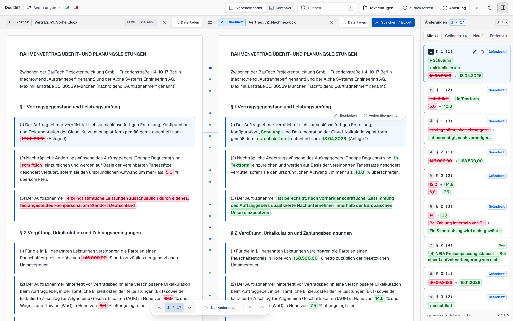

<p align="center">
  <picture>
    <source media="(prefers-color-scheme: dark)" srcset="docs/logo-dark-square.png">
    <source media="(prefers-color-scheme: light)" srcset="docs/logo-light-square.png">
    
  </picture>
</p>

<h1 align="center">Doc Diff</h1>

<p align="center">
  Compare two versions of a document (PDF, Word .docx, or plain text) in the browser and see every changed word.<br>
  The files are processed on your computer and are not uploaded.
</p>

<p align="center">
  <a href="https://docdiff.app">docdiff.app</a> (<a href="https://docdiff.app/en/">English</a>) ·
  <a href="https://github.com/tschnorpfeil/docdiff/raw/main/DocDiff.html">Offline version (single HTML file)</a> ·
  MIT license
</p>

<p align="center">
  <picture>
    <source media="(prefers-color-scheme: dark)" srcset="docs/screenshot-dark.png">
    <source media="(prefers-color-scheme: light)" srcset="docs/screenshot-light.png">
    
  </picture>
</p>

## What it is

Doc Diff is a small tool for one job: you have an old and a new version of a document, typically a contract or a tender, and you want to know exactly what changed. It is free, has no accounts, no ads and no tracking, and the whole app is a single HTML file you can also run offline.

It was written with German contracts in mind (`§ 1`, `(1)`, `1.1` clause numbering), and the interface is in German and English.

## How to use it

1. Open [docdiff.app](https://docdiff.app), or download [`DocDiff.html`](https://github.com/tschnorpfeil/docdiff/raw/main/DocDiff.html) and open it from disk.
2. Choose the old version and the new version (file picker, drag and drop, or paste text). There is a built-in example if you just want to look around.
3. Go through the changes: removed text is struck through in red, added text is green. `J` / `K` or the arrows jump from change to change; the list on the right shows each change in short form.
4. Optionally edit paragraphs of the new version, or take over the old wording for a paragraph, and export the result.

## What it does

- **Inputs:** PDF with a text layer, Word `.docx`, `.html` (text only), and UTF-8/UTF-16 text. Any combination works, e.g. PDF against DOCX.
- **Paragraph alignment, then word diff:** paragraphs of both versions are matched first, then the words inside each matched pair are compared. Inserted and deleted paragraphs show up as such.
- **Faithful output:** unchanged plus removed parts always reproduce the old text exactly, unchanged plus added parts the new text. Tests enforce this.
- **Less noise:**
  - Running headers, footers and page numbers that repeat on at least half of the pages are hidden (toggle "Ohne Kopf-/Fußzeile"). If a header or footer actually differs between versions, it is shown.
  - Renumbering alone (`(1)` → `(2)`, `§ 4` → `§ 5`) is shown in a muted style and not counted as a change.
  - Paragraphs that moved unchanged are labelled "Moved" at both positions.
  - Hyphenated line breaks in PDFs are joined.
- **Views:** original pages, side by side, or one column (default on phones).
- **Editing:** edit a paragraph of the new version in place, or revert it to the old wording, with undo/redo.
- **Export:**
  - Word `.docx` with every difference as a tracked change, so you can accept or reject changes in Word or LibreOffice
  - PDF via the browser's print dialog
  - HTML report (self-contained, read-only)
  - Markdown
  - the final text as `.txt` or to the clipboard
- **Session file:** you can save the current state (both documents plus your edits) as a `.docdiff` file and open it again later. The browser asks before you leave the page with unsaved edits.

## What it does not do

- **No OCR.** Scanned PDFs or images without a text layer are rejected with a message.
- **No legacy `.doc` or `.rtf`.** Save them as `.docx` or PDF first.
- **Formatting is not compared.** Bold, fonts, tables and layout are ignored; only the text is compared. Table cells come through as text in reading order, which can be hard to follow.
- **Multi-column PDF layouts** are read line by line and can come out in the wrong order.
- **Moves are only detected when the moved paragraph is identical.** A paragraph that was moved and edited shows as one deletion and one insertion.
- **Large documents take time.** See [Performance](#performance).
- It is not a legal review tool. It shows differences in the text; whether they matter is up to you.

## Privacy

The documents never leave the browser tab. This is enforced by the browser, not only promised:

- The page sets a Content Security Policy that forbids all network connections from the page (`connect-src 'none'`, `form-action 'none'`):
  ```html
  <meta http-equiv="Content-Security-Policy" content="default-src 'none'; script-src 'unsafe-inline'; style-src 'unsafe-inline'; font-src data:; img-src 'self' data: blob:; manifest-src 'self'; connect-src 'none'; media-src 'none'; object-src 'none'; child-src 'none'; worker-src blob:; frame-src 'none'; form-action 'none'; base-uri 'none';" />
  ```
- All libraries and fonts are inside the HTML file; nothing is loaded from other servers.
- Nothing is stored in the browser (no `localStorage`, `sessionStorage`, IndexedDB or cookies). Closing or reloading the tab discards everything, unless you saved a session file yourself.

You can check this yourself: open the browser's developer tools, switch to the Network tab and compare two files. No request is made. Or use the offline file without an internet connection.

What this does not cover, to be precise:

- Opening docdiff.app is a normal page load from GitHub Pages, which sees your IP address like any web server. The page also loads its own icon and manifest from the same site. The offline file avoids this.
- Browser extensions you have installed can read any page, including this one.
- A `.docdiff` session file and every export contain the document text. Store them as carefully as the documents themselves.

## Performance

PERFORMANCE_PLACEHOLDER

## Keyboard

| Key | Action |
| :-- | :-- |
| `J` / `K` | Next / previous change |
| `/` | Search |
| `C` | Show only changes |
| `H` | Hide or show headers and footers |
| `Ctrl+Z` / `Cmd+Z` | Undo an edit |
| `Ctrl+Y`, `Shift+Cmd+Z` | Redo |
| `Esc` | Close menus and dialogs |

Single-key shortcuts only work while a comparison is shown and not while typing. They can be switched off in the help dialog.

## Building from source

The app is plain HTML, CSS and JavaScript without a framework or package manager. The sources are in [`src/`](src):

- `src/template.html`: page shell and markup
- `src/styles.css`: styles
- `src/js/*.js`: application code, concatenated in file-name order into one inline script

```sh
python3 scripts/build.py   # writes site/index.html, site/en/index.html and DocDiff.html
node scripts/check.mjs     # invariants and tests
```

`scripts/check.mjs` verifies the Content Security Policy, the absence of external URLs and storage APIs, matching German and English strings, the search metadata of both language pages (title, canonical, hreflang, JSON-LD that matches the visible FAQ, sitemap, `llms.txt`), and runs the unit tests for the diff core (`scripts/test-core.mjs`) and the export builders (`scripts/test-export.mjs`). CI runs the same and also checks that the committed bundle is up to date.

Bundled libraries: [PDF.js](https://github.com/mozilla/pdf.js), [Mammoth.js](https://github.com/mwilliamson/mammoth.js), [jsdiff](https://github.com/kpdecker/jsdiff), and the [Geist](https://vercel.com/font) fonts. Versions and licenses are listed in [THIRD_PARTY_NOTICES.md](THIRD_PARTY_NOTICES.md).

## Contributing and security

See [CONTRIBUTING.md](CONTRIBUTING.md). Please report security issues privately as described in [SECURITY.md](SECURITY.md).

## License

MIT, see [LICENSE](LICENSE).
